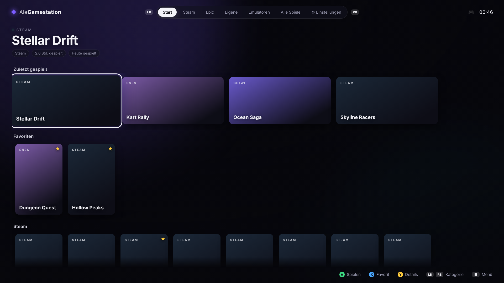
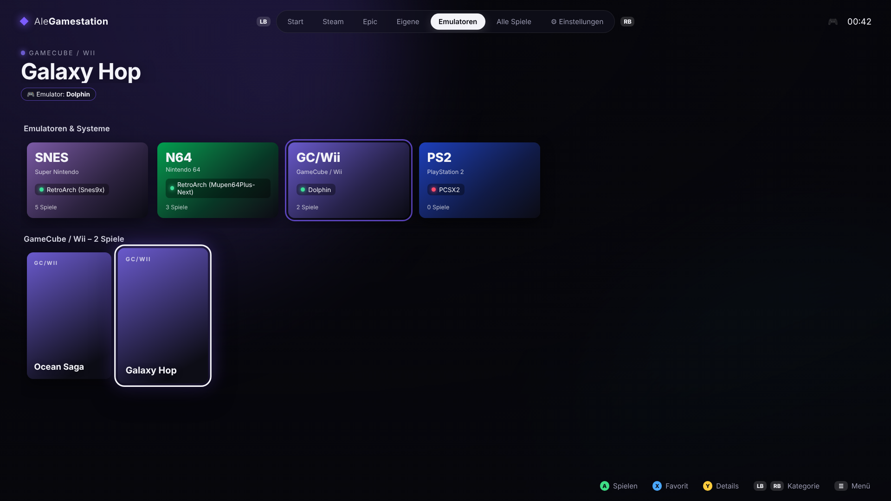
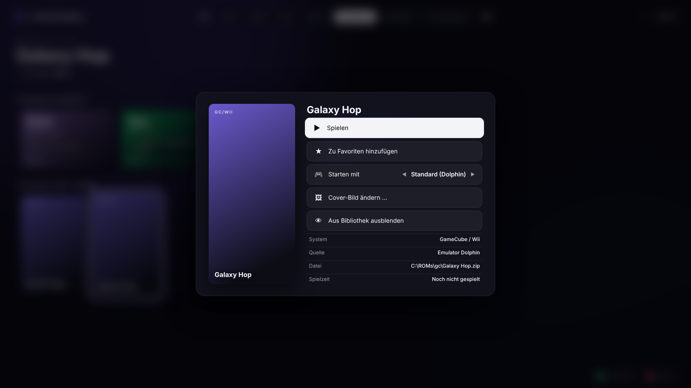
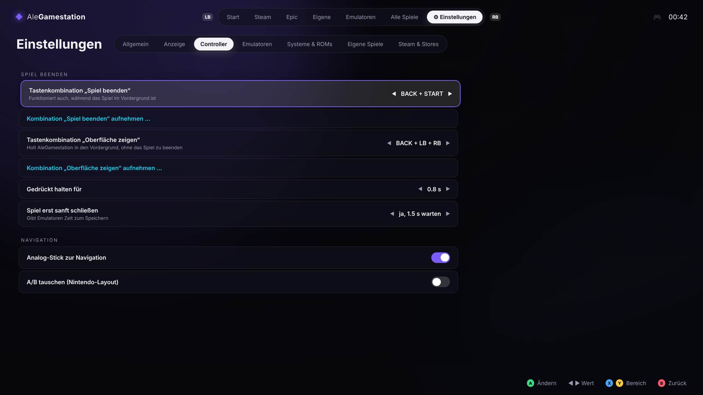

# AleGamestation 🎮

Verwandelt deinen Windows-PC in eine **Konsole für den Fernseher** – ähnlich wie Steam Big Picture oder EmulationStation:
Alle Spiele (Steam, Epic, GOG, eigene) und Emulator-Spiele in einer modernen Oberfläche, komplett mit dem Controller bedienbar.



## Funktionen

**Bibliothek**
- **Automatische Erkennung** von Steam-, Epic- und GOG-Spielen (inkl. Steam-Coverbildern)
- **Emulatoren-Ansicht**: oben die Emulatoren/Systeme (mit Status *gefunden / nicht gefunden*), darunter deren Spiele
- Auf jeder Spielkachel und in den Details siehst du, **mit welchem Emulator** das Spiel startet – und kannst es **pro Spiel ändern**
- **Eigene Spiele/Programme hinzufügen** (z. B. Kodi, Spiele ohne Launcher) direkt in der Oberfläche
- ROM-Ordner werden durchsucht (inkl. Unterordner), Covers werden automatisch erkannt (`Spielname.png` im Ordner, in `covers/` oder `media/covers/`)
- **Dateien ausblenden**: Update-, DLC- und Patch-Dateien (z. B. Switch-Updates `[v65536]`, `(Update)`, `[DLC]`, Ordner `Updates`) werden automatisch versteckt; eigene Regeln wie `Demo ; (Beta) ; Bonus` pro Konsole unter Einstellungen → Systeme & ROMs. Dort lassen sich einzelne Dateien auch wieder einblenden
- **Konsolen-Sounds**: sanfte, glockenartige Menüklänge mit Hall (Thema „Modern“), alternativ „Retro (8-Bit)“, Lautstärke einstellbar, Start-Klang
- **Automatische Updates** direkt von GitHub
- **Home Assistant**: Fernseher beim Start einschalten und auf den richtigen HDMI-Eingang schalten
- **Maus & Tastatur per Controller** – nie wieder zur Tastatur greifen
- **DualSense-Touchpad als Maus** außerhalb von Spielen
- **Cover-Download** für ROMs (libretro-thumbnails ohne Konto, optional ScreenScraper) inkl. Screenshots als Hintergrund
- Startseite mit Regalen: *Zuletzt gespielt*, *Favoriten*, je Store/System eine Reihe
- Favoriten, **Spielzeit-Statistik**, „zuletzt gespielt“, eigene Cover, Spiele ausblenden
- „Alle Spiele“ mit Buchstaben-Sprung (LT/RT)
- Kachel „Steam Big Picture öffnen“

**Konsolenmodus**
- **Leistungsmodus**: Hintergrundprogramme beim Start pausieren oder beenden und beim Verlassen wiederherstellen – z. B. Wallpaper Engine (voreingestellt), OneDrive, Teams, iCUE … Empfehlungen per Klick, oder aus den laufenden Programmen wählen. Optional Energieplan „Höchstleistung“
- Beim Start **Bildschirm umschalten** (nur TV / nur PC-Monitor / duplizieren / erweitern – wie Win + P), beim Beenden wiederherstellen
- **Fernseher festlegen**: Einstellungen → Anzeige → „Mein Fernseher“ (mit „Bildschirme identifizieren“). „Nur Fernseher“ schaltet genau diesen Bildschirm als einzigen ein – auch bei mehreren Monitoren. „Fernseher als Hauptbildschirm“ lässt alle Monitore an und macht nur den TV zur Hauptanzeige, damit Spiele dort starten (beim Beenden wird der alte Hauptbildschirm zurückgesetzt)
- Eigene Befehle beim Start/Beenden (z. B. Tonausgabe auf den TV umstellen)
- **Herunterfahren, Neustart, Energiesparen, zurück zum Desktop** direkt per Controller
- Autostart mit Windows, Vollbild auf wählbarem Bildschirm, Mauszeiger wird ausgeblendet

**Controller**
- **PlayStation-Controller werden erkannt** (DualSense, DualSense Edge, DualShock 4): Oberfläche zeigt ✕ ○ □ △, L1/R1, Options, PS. Xbox- und Nintendo-Symbole ebenfalls – automatisch oder fest einstellbar
- PlayStation-Controller werden per USB/Bluetooth **direkt ausgelesen** – die Beenden-Kombination (*Create + Options*) funktioniert ohne Steam Input oder DS4Windows
- **Boot-Animation** und **Spielstart-Animation**
- **Konsolen-Overlay** (PS-Taste halten): Spiel beenden, Spiel wechseln, Spotify, Lautstärke
- **PS-Taste im Spiel öffnet ein Schnellmenü** über dem Spiel: ✕ Spiel beenden (mit Rückfrage), △ zur Oberfläche, ○ weiterspielen
- **Tastenkombination zum Beenden von Spielen/Emulatoren** (Standard: `BACK + START` 0,8 s halten) – funktioniert **auch, während das Spiel im Vordergrund ist**
- Zweite Kombination, um die Oberfläche hervorzuholen, ohne das Spiel zu beenden (Standard: `BACK + LB + RB`)
- Kombinationen frei wählbar oder **direkt am Controller aufnehmen**
- Sanftes Beenden (Emulatoren können noch speichern), danach hartes Beenden inkl. aller Unterprozesse
- Nintendo-Layout (A/B tauschen), Analog-Stick-Navigation

| Emulatoren | Spiel-Details | Einstellungen |
|---|---|---|
|  |  |  |

## Installation

1. Unter **[Releases](https://github.com/AleB-Roni/AleGamestation/releases/latest)** die Datei `AleGamestation-Setup-x.y.z.exe` herunterladen
2. Installer starten. Da die App nicht kostenpflichtig signiert ist, zeigt Windows evtl. „Der Computer wurde durch Windows geschützt“ → **Weitere Informationen → Trotzdem ausführen**
3. AleGamestation über das Desktop-Symbol starten – am besten in den Einstellungen **„Mit Windows starten“** aktivieren

### Updates

**Menü (☰ / Options) → „Nach Updates suchen“** fragt GitHub nach der neuesten Version und zeigt installierte und neue Version sowie die **Liste der Änderungen**. Von dort: **Herunterladen & installieren** (mit Fortschrittsbalken), später installieren oder die Release-Seite öffnen.

- Beim Start und alle 6 Stunden wird automatisch gesucht; ein verfügbares Update erscheint oben als **„⬆ Update“**-Hinweis
- Updates werden im Hintergrund geladen (abschaltbar: dann wird erst nachgefragt) und erst installiert, wenn du es bestätigst oder die App beendest
- Einstellungen unter **Einstellungen → Info & Updates**

### Selbst bauen / entwickeln

Voraussetzung: [Node.js](https://nodejs.org) (LTS).

```bash
npm install
npm start          # Konsolenmodus starten
npm run dev        # Fenster-Modus zum Testen (ohne Bildschirmumschaltung)
npm run dist       # Installer lokal erstellen (Ordner dist/)
```

### Neue Version veröffentlichen

Die Änderungsliste im Update-Fenster wird automatisch aus den Commit-Nachrichten seit der letzten Version erzeugt.


1. Version in `package.json` erhöhen (z. B. `1.0.1`) und committen
2. Auf GitHub **Actions → Release → „Run workflow“** klicken (oder Tag pushen: `git tag v1.0.1 && git push origin v1.0.1`)
3. GitHub Actions baut den Windows-Installer und veröffentlicht das Release – alle installierten Apps aktualisieren sich dann selbst

## Bedienung

| Taste | Bibliothek | Einstellungen |
|---|---|---|
| Steuerkreuz / Stick | Navigieren | Navigieren |
| **A** | Spiel starten | Ändern / Auswählen |
| **B** | Zurück | Zurück |
| **X** | Favorit an/aus | |
| **Y** | Details (Emulator wählen, Cover, ausblenden …) | |
| **L1 / R1** (LB / RB) | Bereich wechseln, in „Alle Spiele“: Buchstaben-Sprung | Bereich wechseln |
| **L2 / R2** (LT / RT) | Kategorie (große Tabs) wechseln | Kategorie wechseln |
| **☰ Start** | Menü (Herunterfahren, Bildschirm, …) | |
| **⧉ Back** | Einstellungen | Zurück |
| **BACK + START halten** | Laufendes Spiel beenden | |
| **PS- / Xbox-Taste** (im Spiel) | Schnellmenü: ✕ Spiel beenden · △ Zur Oberfläche · ○ Weiterspielen | |

**Tastatur** (komplett bedienbar, Symbole wechseln automatisch zwischen Tastatur und Controller):

| Taste | Funktion |
|---|---|
| WASD / Pfeiltasten | Navigieren |
| Leertaste / Enter | Auswählen / Starten |
| Esc / Rücktaste | Zurück |
| Q / E | Kategorie (große Tabs) wechseln |
| F | Favorit |
| R / Tab | Details |
| Z / C | Bereich wechseln / Buchstaben-Sprung |
| M | Menü |
| O | Einstellungen |

## Debug-Modus (Fehlersuche)

**Einstellungen → Info & Updates → Debug-Modus** einschalten (oder die App mit `--ags-debug` starten). Oben erscheint „DEBUG“ – bei Fehlern rot mit Anzahl.

Protokolliert werden: jede Eingabe mit aktueller Ansicht und Auswahl, Fehler aller Fenster (Oberfläche, Overlay), Anfragen an die App mit Dauer, Bildschirm-Umschaltungen, Controller-Verbindungen, Spielstart/-ende und Meldungen. Das Protokoll liegt unter `%APPDATA%\AleGamestation\logs\debug.log`.

**Debug-Bericht erstellen** (Einstellungen → Info & Updates oder ☰ Menü) speichert Protokoll, Systeminfos, Bildschirme, Controller und Einstellungen als Textdatei auf dem Desktop. Passwörter, Tokens und API-Schlüssel werden dabei unkenntlich gemacht.

## Emulatoren im Vollbild starten

Unter **Einstellungen → Emulatoren → „Spiele im Vollbild starten“** (Standard: an) ergänzt AleGamestation bei bekannten Emulatoren automatisch das Vollbild-Argument – auch wenn es nicht in den Start-Argumenten steht:

| Emulator | Vollbild-Argument | Empfohlene Start-Argumente |
|---|---|---|
| Eden, Citron, Sudachi, Suyu, Torzu, yuzu (Switch) | `-f` | `-f -g "{rom}"` |
| Ryujinx (Switch) | `--fullscreen` | `--fullscreen "{rom}"` |
| Cemu (Wii U) | `-f` | `-f -g "{rom}"` |
| Dolphin (GameCube/Wii) | `-C Dolphin.Display.Fullscreen=True` | `-b -C Dolphin.Display.Fullscreen=True -e "{rom}"` |
| Azahar / Lime3DS / Citra (3DS), melonDS, mGBA, RetroArch | `-f` | |
| DuckStation, PCSX2 | `-fullscreen` | `-batch -fullscreen -- "{rom}"` |
| RPCS3 | `--fullscreen` | `--no-gui --fullscreen "{rom}"` |
| PPSSPP | `--fullscreen` | `--fullscreen "{rom}"` |
| xemu, Xenia, Vita3K, Snes9x, Mesen | jeweils passend | |

Pro Emulator lässt sich das abschalten; dort steht auch, was erkannt wurde, und ein Knopf übernimmt die empfohlenen Start-Argumente. Neu hinzugefügte Emulatoren bekommen Namen und Start-Argumente automatisch. Flycast und Project64 haben kein Vollbild-Argument – dort im Emulator „im Vollbild starten“ einschalten. Notfalls hilft im Spiel **Vollbild (F11)** im Overlay oder □ im Schnellmenü.

## Konsolen-Overlay (PS-/Xbox-Taste gedrückt halten)

Während eines Spiels die **PS-Taste** (Xbox: Guide-Taste) **gedrückt halten** öffnet ein Menü über dem Spiel:

- **Weiterspielen**, **Zur Oberfläche**, **Vollbild (F11)** (sendet F11 an das Spiel – bei den meisten Emulatoren/Spielen Vollbild an/aus), **Spiel beenden** (mit Rückfrage)
- **Schnellstart**: zuletzt gespielte Spiele – das laufende Spiel wird beendet und das gewählte gestartet
- **Musik**: aktueller Spotify-Titel mit Cover und Fortschritt, ⏮ ⏯ ⏭, Zufallswiedergabe und **Playlists auswählen** – Spotify bleibt dabei im Hintergrund (läuft es nicht, wird es minimiert gestartet). Einrichten unter **Einstellungen → Spotify** (eigene Spotify-App mit Client-ID, Steuerung braucht Premium). Ohne Verbindung: ⏮ ⏯ ⏭ über die Windows-Medientasten
- **Clip speichern** (mit [AleClip](https://github.com/AleB-Roni/AleClip)): die letzten 15 s / 30 s / 1 Min / 2 Min … als Clip, **Screenshot**, **Aufnahme** starten/stoppen, Instant Replay an/aus – wie die Create-Taste bei der PlayStation. Der Clip endet beim Öffnen des Overlays, das Menü ist nicht zu sehen. Einstellungen → **Clips** (AleClip wird automatisch gefunden und minimiert mitgestartet; die maximale Länge ist die Puffer-Länge in AleClip)
- **System**: Lautstärke leiser/lauter/stumm, Maussteuerung

Das Overlay erscheint **über Spielen und Emulatoren im Vollbild** (Einstellungen → Controller → Overlay-Modus):
- **Spiel anhalten** (Standard): Das Spiel wird eingefroren, solange Overlay oder Schnellmenü offen sind – es bleibt im Vollbild sichtbar, reagiert aber nicht auf den Controller, und läuft beim Schließen genau dort weiter. Für **Online-Spiele** besser „Nur darüberlegen“ wählen (Anhalten kann die Verbindung trennen)
- **Nur darüberlegen**: Das Spiel läuft weiter und sieht die Controller-Eingaben mit
- **Fokus holen**: Das Spiel bekommt keine Eingaben; Spiele im exklusiven Vollbild minimieren sich dabei kurz und kommen beim Schließen zurück
- Overlay und Einblendungen sind in Aufnahmen und Clips (AleClip, OBS, Discord) unsichtbar
- Bei **echtem exklusivem Vollbild** kann Windows kein Fenster darüber zeichnen – im Spiel/Emulator „Randloses Vollbild“ wählen

**Kurz drücken** öffnet das kleine Schnellmenü (✕ beenden · □ Vollbild/F11 · △ Oberfläche · ○ weiterspielen). Beides unter **Einstellungen → Controller** anpassbar.
Hinweis: Läuft Steam, kann die PS-Taste zusätzlich Steam öffnen – in Steam unter *Einstellungen → Controller → Guide-Tasten-Verknüpfungen* abschalten.

## Home Assistant – Fernseher automatisch einschalten

Beim Start schaltet AleGamestation den Fernseher über Home Assistant ein, wartet bis er an ist und wechselt auf den gewählten **HDMI-Eingang** – erst danach wird das Bild auf den TV umgeschaltet.

1. In Home Assistant: **Profil → Sicherheit → Langlebiges Zugangstoken erstellen**
2. In AleGamestation: **Einstellungen → Home Assistant** → Adresse (z. B. `http://homeassistant.local:8123`) und Token eintragen → **„Verbindung testen & Geräte laden“**
3. Fernseher und HDMI-Eingang auswählen (die Eingangsliste kommt direkt vom Fernseher)

Optional: Fernseher beim Herunterfahren / Zurückkehren zum Desktop ausschalten oder auf einen anderen Eingang schalten, und eigene Aktionen beim Start/Beenden (z. B. `scene.gaming`, `script.licht_dimmen`, `light.turn_off:light.decke`).
**Fernseher lässt sich über Home Assistant nicht einschalten?** Viele Fernseher sind in Home Assistant „nicht verfügbar“, solange sie aus sind. Dann unter **Einstellungen → Home Assistant → Einschalten über** ein anderes Gerät wählen, z. B. den **Chromecast** am Fernseher (weckt den TV per HDMI-CEC) oder ein Skript. AleGamestation wartet, bis der Fernseher in Home Assistant auftaucht, wählt dann den eingestellten HDMI-Eingang und prüft, dass er dort bleibt (der Chromecast schaltet den TV beim Wecken oft auf seinen eigenen Eingang). Genauso gibt es **Ausschalten über**.

Funktioniert mit allen Fernsehern, die Home Assistant als Mediaplayer kennt (LG webOS, Samsung, Sony Bravia, Android TV, Philips …). Ob ein ausgeschalteter Fernseher eingeschaltet werden kann, hängt von der jeweiligen Integration ab (bei LG z. B. per Wake-on-LAN-Automation).

## Maus & Tastatur per Controller

Für Launcher-Fenster, Logins oder den Browser: **Create + △** (Xbox: View + Y) kurz halten schaltet die Maussteuerung ein bzw. aus – überall in Windows, auch über anderen Programmen. Eine Einblendung oben zeigt den Status.

| Controller | Funktion |
|---|---|
| Linker Stick | Maus bewegen (R2/RT halten = langsam & präzise) |
| Rechter Stick | Scrollen |
| ✕ / A | Linksklick (halten = ziehen) |
| ○ / B | Rechtsklick |
| □ / X | Bildschirmtastatur ein/aus |
| △ / Y | Enter |
| Steuerkreuz | Pfeiltasten |
| L1 / LB | Alt+Tab (Fenster wechseln) |
| R1 / RB | Tab |
| L2 / LT | Rücktaste |
| Options / Start | Esc |
| L3 | Mittelklick |

Kombination und Mausgeschwindigkeit sind unter **Einstellungen → Controller** einstellbar.

### Touchpad als Maus (DualSense / DualShock 4)

Außerhalb von Spielen funktioniert das Touchpad wie am Laptop – ganz ohne Umschalten:

| Touchpad | Funktion |
|---|---|
| 1 Finger bewegen | Maus bewegen |
| Drücken | Linksklick (gedrückt halten = ziehen) |
| Mit 2 Fingern drücken | Rechtsklick |
| Kurz antippen (1 / 2 Finger) | Links- / Rechtsklick |
| 2 Finger bewegen | Scrollen |

Sobald ein Spiel läuft, gehört das Touchpad wieder dem Spiel. Einstellbar unter **Einstellungen → Controller** (immer außerhalb von Spielen / nur in der Maussteuerung / aus, Geschwindigkeit, Antippen).

## Cover herunterladen

ROMs bekommen automatisch **Box-Art und Screenshots** (Screenshots erscheinen als Hintergrund hinter dem ausgewählten Spiel):

- **libretro-thumbnails** – kostenlos, ohne Konto, sofort aktiv. Funktioniert am besten mit ROMs im üblichen No-Intro/Redump-Namensformat (z. B. `Super Mario World (USA).sfc`), erkennt aber auch unsaubere Namen wie `super_mario_world.sfc`
- **ScreenScraper.fr** – optional, größte Datenbank, erkennt ROMs zusätzlich über Dateigröße und Prüfsumme. Benötigt ein kostenloses Konto **und** einen Entwickler-Zugang (devid/devpassword, im ScreenScraper-Forum zu beantragen). Eintragen unter **Einstellungen → Cover**

Fehlende Cover werden beim Start automatisch im Hintergrund geladen. Manuell: **Menü → „Fehlende Cover herunterladen“**, pro System (Emulatoren-Tab → Y) oder pro Spiel (Details → „Cover herunterladen“). Der offizielle Spielname wird dabei gleich mit übernommen.
Bilder liegen in `%APPDATA%\AleGamestation\media` (Speicherort änderbar). Eigene Bilder neben der ROM (`Spielname.png` oder `covers\Spielname.png`) haben Vorrang.

### Bilder für PC-Spiele (Steam, Epic, GOG, eigene)

- **Steam-Spiele** bekommen Cover und Hintergrund direkt von Steams Bilderserver – auch wenn Steam sie lokal noch nicht geladen hat
- **Epic-, GOG- und eigene Spiele** werden im Steam-Shop gesucht und übernehmen dessen Bilder (funktioniert für alle Spiele, die es auch auf Steam gibt)
- **Optional SteamGridDB**: Für Spiele ohne Steam-Version (z. B. Fortnite) einen kostenlosen API-Schlüssel von steamgriddb.com (Profil → Einstellungen → API) unter **Einstellungen → Cover** eintragen
- Neu hinzugefügte Spiele bekommen ihr Cover sofort; eigene Bilder gehen immer über Details → „Cover-Bild ändern“

## Einrichtung der Emulatoren

1. **Einstellungen → Emulatoren → „Installierte Emulatoren automatisch suchen“** (findet RetroArch, Dolphin, PCSX2, DuckStation, PPSSPP, melonDS an typischen Orten)
2. Sonst Pfad zur `.exe` manuell eintragen. Start-Argumente nutzen Platzhalter: `{rom}`, `{romName}`, `{romDir}`, `{emuDir}`
3. **Einstellungen → Systeme & ROMs**: ROM-Ordner, Dateiendungen und Standard-Emulator je System festlegen
4. Einzelnes Spiel mit anderem Emulator starten: Spiel auswählen → **Y** → „Starten mit“

Vorbelegte Beispiele (anpassbar):

| System | Emulator | Argumente |
|---|---|---|
| NES / SNES / N64 / GBA / Mega Drive | RetroArch + Core | `-f -L cores\snes9x_libretro.dll "{rom}"` |
| GameCube / Wii | Dolphin | `-b -e "{rom}"` |
| PS1 | DuckStation | `-batch -fullscreen -- "{rom}"` |
| PS2 | PCSX2 | `-batch -fullscreen -- "{rom}"` |
| PSP | PPSSPP | `--fullscreen "{rom}"` |
| NDS | melonDS | `-f "{rom}"` |

## Gut zu wissen

- **Controller**: Die globale Beenden-Kombination funktioniert mit Xbox-Controllern (XInput) und PlayStation-Controllern (direkt per HID). Switch-Controller brauchen dafür Steam Input. In der Oberfläche selbst funktionieren alle gängigen Controller.
- **Falscher Bildschirm?** In Einstellungen → Anzeige den Fernseher festlegen und „Beim Start“ auf „Nur Fernseher (ausgewählt)“ stellen.
- **Bildschirm „nur TV“** setzt voraus, dass Windows den TV als zweiten Bildschirm erkennt. Klappt es nicht, im Menü → „Bildschirm umschalten“ testen und die Wartezeit in Einstellungen → Anzeige erhöhen.
- **Ton auf den TV**: z. B. mit [NirCmd](https://www.nirsoft.net/utils/nircmd.html): Einstellungen → Anzeige → Befehle beim Start: `nircmd setdefaultsounddevice "LG TV"`.
- Spiel lässt sich nicht per Controller beenden? Bei eigenen Spielen „Beenden per Controller“ auf *Alle Prozesse aus dem Spielordner* oder *Nach Prozessname* stellen.
- Alle Einstellungen liegen in `%APPDATA%\AleGamestation\config.json` (Menü → Einstellungen → Allgemein → „Konfigurationsdatei öffnen“).

## Projektstruktur

```
src/main/        Electron-Hauptprozess
  main.js          Fenster, Konsolenmodus, IPC
  library.js       Steam/Epic/GOG/ROM-Erkennung, Emulator-Autoerkennung
  launcher.js      Spiele starten, überwachen, beenden
  gamepad-watcher.js + xinput-watcher.ps1   globale Controller-Kombinationen
  system.js        Bildschirm umschalten, Herunterfahren
  config.js        Konfiguration mit Standardwerten
src/renderer/    Oberfläche (HTML/CSS/JS, Controller-Navigation)
test/            Tests (npm test)
```

## Lizenzen

- Icons: [Lucide](https://lucide.dev) (ISC-Lizenz, siehe `licenses/lucide-LICENSE.txt`) – neu übernehmen mit `npm run icons`
- Konsolen-Abbildungen: eigene Zeichnungen
